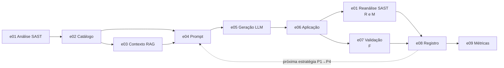

# Arquitetura do pipeline: dutos e filtros

O pipeline segue o estilo **dutos e filtros** (*pipes and filters*). Cada etapa do experimento é um
**filtro**: lê artefatos de entrada e grava artefatos de saída. Os **dutos** são esses artefatos, quase
todos em JSON, gravados na pasta de cada execução. O orquestrador (`orquestracao/campanha.py`) só encadeia
as etapas e não guarda estado próprio entre elas.

As pastas de `etapas/` seguem a Figura 2 e as 13 etapas do §3.8 do TCC 1, na ordem do fluxo.



## Estrutura

```text
src/pipeline/
  etapas/
    e01_analise_sast/    semgrep, perfil, comparacao, estrutura (.py e .cjs)
    e02_catalogo/        catalogo, associacoes
    e03_contexto_rag/    recuperacao
    e04_prompt/          montagem
    e05_geracao_llm/     provedor, cliente_openai, cliente_colab, protocolo_colab, resposta_simulada, esquema
    e06_aplicacao/       aplicador, indentacao, worktrees
    e07_validacao/       medicao, politicas, cobertura, execucao_cobertura, preparo_api_cobertura.mjs,
                         selecao, camadas, conjunto_d, preparacao_api, auditoria_cobertura, cache, repeticao
    e08_registro/        registro
    e09_metricas/        leitura, normalizacao, calculo, publicacao, rris
  orquestracao/          campanha (orquestrador), preflight (preflight e contrato)
  comum/                 caminhos, identidade, componentes
  painel/                servidor, controle, web/ (interface)
  legado/                filtro, comparacao_v1 (modo histórico E01–E03)
```

## Etapas, filtros e dutos

| Etapa | Passos do §3.8 | Filtros | Entrada | Saída (duto) |
|---|---|---|---|---|
| `e01_analise_sast` | 1 e 10 | `semgrep.py` (roda e normaliza o Semgrep), `perfil.py` (perfil de regras congelado), `comparacao.py` (antes × depois por ocorrência: decide R e M), `estrutura.py` + `estrutura.cjs` (árvore sintática TypeScript) | código do alvo na worktree; perfil em `config/perfis/` | `sast_antes/baseline_raw.json`, `sast_antes/reproducao.json`; depois do patch, `sast_depois/<ID>_raw.json` e `comparacoes/<ID>.json` |
| `e02_catalogo` | 2, 3, 4 | `catalogo.py` (carrega e confere); `associacoes.py` (alerta ↔ desafio); a geração é feita por `scripts/experimento/gerar_catalogo_ampliado.py` | scan arquivado; `config/mapa_*.yaml` | `outputs/catalogos/ampliado_v1/catalogo_issues.json` |
| `e03_contexto_rag` | 5 | `recuperacao.py` (CWE → categoria → genérico) | caso; `knowledge_base/` | documento recuperado (campos `rag_*` da tentativa) |
| `e04_prompt` | 6 | `montagem.py` (P1, P2, P3, P4 e o diagnóstico P1L); roteiro em `config/prompts/roteiro_raciocinio_guiado.md` | caso, trecho do código, alerta (P3/P4), contexto (P3/P4) | `prompts/<ID>.json` |
| `e05_geracao_llm` | 7, 8 | `provedor.py` (escolhe OpenAI ou Colab), `cliente_openai.py`, `cliente_colab.py`, `protocolo_colab.py`, `resposta_simulada.py` (dry-run), `esquema.py` (formato JSON da resposta) | prompt | `respostas_llm/<ID>.json` |
| `e06_aplicacao` | 9 | `worktrees.py` (empresta e restaura as cópias `wt-1..K`), `aplicador.py` (aplica por âncora), `indentacao.py` (âncora com recuo diferente) | resposta; worktree limpa | `patches/<ID>.diff`, `codigos_corrigidos/<ID>/` |
| `e07_validacao` | 11 | `medicao.py` (mede R, F e M de uma tentativa), `politicas.py`, `cobertura.py`, `execucao_cobertura.py`, `selecao.py`, `camadas.py`, `conjunto_d.py`, `preparacao_api.py` | código corrigido; baseline funcional | `testes/<ID>.json` |
| `e08_registro` | 12 | `registro.py` (uma linha por tentativa) | resultados da tentativa | `resultados_consolidados/execucoes.jsonl` |
| `e09_metricas` | Figura 1, etapa 3 | `leitura.py`, `normalizacao.py`, `calculo.py`, `publicacao.py`, `rris.py`; comando `scripts/relatorios/consolidar_metricas.py` | `execucoes.jsonl` e artefatos | pasta irmã `<EXECUCAO>_METRICAS/` |

O passo 13 (restaurar o projeto para a próxima tentativa) é feito por `e06_aplicacao/worktrees.py`. `<ID>` é o
identificador da tentativa, `<CASO>_<OWASP>_<VULN>_<PROMPT>_<EXECUCAO>`, como na Figura 3 do TCC (ver
`outputs/README.md`). Os caminhos da coluna "Saída" são relativos à pasta da execução.

## Orquestração, peças comuns e interfaces

| Arquivo | Papel |
|---|---|
| `orquestracao/campanha.py` | Orquestrador (Figura 2): distribui os casos em K worktrees em paralelo e roda P1 → P4 em sequência, parando no primeiro aceite. `main` → `processar_caso` → `tentativa`. |
| `orquestracao/preflight.py` | Preflight e contrato da execução: confere perfil, worktrees, cobertura e baseline; reproduz o SAST inicial; gera os prompts; recusa retomar com contrato diferente. |
| `comum/caminhos.py` | Raiz do repositório e caminhos relativos nos JSON. |
| `comum/identidade.py` | "Impressão digital" do ambiente: versões, lockfiles, dependências, builds. |
| `comum/componentes.py` | Lista dos arquivos de código que entram no contrato da execução e no cache. |
| `painel/servidor.py`, `painel/controle.py`, `painel/web/` | Painel web local e a interface dele. |
| `../../executar.py` | Atalho de linha de comando: monta o comando do orquestrador e depois o da consolidação. |

## Legado e experimental

| Arquivo | Situação |
|---|---|
| `legado/filtro.py`, `legado/comparacao_v1.py` | Filtro e comparador v1 do modo histórico (catálogo JS001–JS012, execuções E01–E03). |
| `e07_validacao/camadas.py` (parte T0–T4) | Validação em camadas da política `historica_v1`. As funções de execução de testes são usadas também pela política atual. |
| `e07_validacao/cache.py` | Cache de evidências de validação. A campanha rodou com `cache_validacao: desligado`. |
| `e07_validacao/repeticao.py` | Repetição seletiva experimental. A campanha usou `repeticao_api: ampla`. |
| `e07_validacao/auditoria_cobertura.py` | Auditoria só de leitura da cobertura funcional por caso. |
| `e09_metricas/rris.py` | Leitor da evidência conjunta da RRIS. Ainda não há essa evidência, por isso a RRIS sai como indisponível. |

## Identidade do código

O nome, o caminho e o conteúdo de parte destes arquivos entram na identidade científica do experimento:

- o baseline funcional guarda o nome e o conteúdo de `e07_validacao/cobertura.py`, `execucao_cobertura.py`,
  `conjunto_d.py`, `preparacao_api.py` e `preparo_api_cobertura.mjs`;
- a referência Docker (`docker/referencia.json`) confere esses arquivos por caminho, além de
  `e07_validacao/camadas.py` e `comum/identidade.py`;
- o contrato de cada execução registra caminho e hash dos arquivos listados em `comum/componentes.py`.

Mover, renomear ou editar esses arquivos exige gerar de novo o baseline e a referência
(`make docker-baseline`). Foi o que se fez na reorganização de 26/10/2026: a referência anterior está em
`docker/historico/referencia_oficial_v1.json`. A correspondência entre os nomes antigos e os atuais está em
`docs/historico/README.md`.
